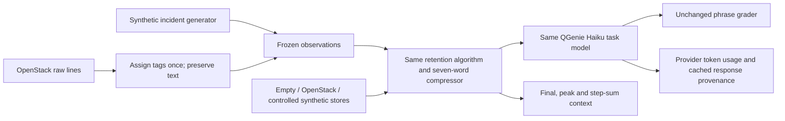

# Contribution: matched lesson policies and context selectivity

This study extends the existing three-seed replay/transfer validation to the team's OpenStack task data and hosted Haiku execution. It asks which benefits remain when compression is held constant, and how broad lesson matching affects context growth.

The [generated results](../results/openstack-lesson-study/RESULTS.md), [HTML report](../results/openstack-lesson-study/RESULTS.html), [figure](../results/openstack-lesson-study/rule-selectivity.pdf) and [verification record](../results/openstack-lesson-study/verification.json) contain the measured evidence.

## What the lesson store actually does

The saved OpenStack summary contains a `learned_lessons_a` JSON array. It has one transferable rule with support 13 and two candidates with support 1 each. Candidates are excluded by default. A lesson's instruction is an inspectable description; the manager executes a matching rule by choosing KEEP rather than the harmful compression/archive operation.

The usable OpenStack rule has tags `critical` and `hard_constraint`. Current retrieval matches either tag. The experimental all-tags adapter requires both. This adapter is confined to the study; the project default is unchanged.

The comparison's synthetic source is the existing **controlled fact-retention seed-7 store**, containing three transferable rules with support 8 each. It is distinct from the historical incident pilot's four reported rules, whose original store and raw traces are absent from this checkout. The hosted synthetic tasks come from the team's existing incident generator.

## Scientific controls



- Two cases per family, selected before outcomes, for each of six families in each dataset: 24 cases and four conditions per case.
- Full context is a reference. The three managed conditions share the explicitly lossy first-seven-words compressor; only the frozen lesson store changes.
- OpenStack tagging runs once per case and is reused. Raw log lines are preserved rather than rewritten. The question is appended as an explicit trigger.
- The task agent receives only visible context and the question. Required/forbidden answers, family labels and lesson support are excluded from its prompt.
- Imports preserve support/status. No learning or threshold tuning occurs during evaluation.
- Identical prompts reuse the same recorded response. Such cache hits are not additional independent observations.
- Source policies differ in rule count/tag coverage. Differences between their results cannot be attributed solely to the source domain.

## Why measure more than final words?

Existing mean active context counts whitespace-separated words in the final active ledger, including observation IDs. Archived originals do not count, and a compressed view counts its summary.

The new study also records the peak observed context and the sum of active words after each management step. That step-sum measures context exposure at observation steps; it is **not billed input tokens**, because the task model is called only at the end. Provider-reported input/output tokens are recorded separately, including investigation calls. Shared preprocessing is reported separately from task calls.

## Offline noise experiment

We add 0, 8 or 32 irrelevant observations tagged only `critical` or only `hard_constraint` to 144 existing fact-retention cases across three seeds. The evaluator knows the requested key/value facts; the frozen executor reads only the question and visible facts. The benign-recent control remains recent. All 2,592 episode ledgers and outcomes are saved.

At 32 added observations, the controlled synthetic store produces:

| Matching | Exact fact success | Mean final words |
|---|---:|---:|
| Any tag | 66.7% | 719.2 |
| All lesson tags | 66.7% | 294.5 |

This is about 59% fewer active words with unchanged fact success on these probes. In contrast, OpenStack's narrower store changes from 50.0% to 33.3% success under stricter matching: it loses protection for delayed facts tagged `critical` plus `delayed_dependency`. The experiment exposes a coverage/selectivity trade-off, rather than establishing one universally better matching policy.

## Hosted findings

All 24 cases completed all four conditions: **96 episode evaluations**. The provider served 96 requests, comprising one preflight, 12 investigations and 83 unique task prompts. Thirteen task evaluations reused identical cached prompts/responses. The provider reported 43,974 input and 13,338 output tokens across those actual requests.

| Dataset | Empty store | OpenStack rules | Controlled synthetic rules | Full context |
|---|---:|---:|---:|---:|
| OpenStack | 3/12 | 7/12 | 8/12 | 7/12 |
| Synthetic incidents | 4/12 | 8/12 | 10/12 | 11/12 |

On OpenStack, its saved rule contributes four paired wins and zero regressions over the empty store. Mean final words are 41.7 with that rule and 200.1 with full context, approximately 79% fewer while matching the full-context score. The broader synthetic store scores 8/12 but uses 116.4 words, illustrating the cost of additional coverage.

On synthetic incidents, the controlled synthetic store contributes six wins and zero regressions over the empty store. It uses 51.9 mean words versus 131.1 for full context, approximately 60% fewer, with a one-case score gap. These observations apply to the selected pilot; they do not establish statistical significance or independent unseen-template generalization.

All source hashes, saved imports, 2,592 offline traces and 96 hosted traces were checked. The verifier reconstructs hosted policy contexts, prompt hashes and grading, and matches answers against cached provider responses.

## Evaluator audit and evidence limits

Eight hand-authored answer fixtures test clear semantic cases. Four disagree with the current phrase grader. The audit exposes post-nominal negation, unrelated negation in the six-word window, negated synonyms and dismissed alternatives. These fixtures diagnose failure modes; they do not estimate grader accuracy on production answers.

We retain the existing grader throughout the hosted comparison. Full-context failures, paired improvements and regressions require answer-level inspection. The original report's synthetic and log percentages remain historical results with differing compressors; the new study does not overwrite them.

The [review of all six failed full-context cases](../results/openstack-lesson-study/FULL_CONTEXT_REVIEW.md) identifies negation/phrase-matching problems and retains a domain-review caveat for one migration recommendation. No scores were changed after inspecting outcomes.

The hosted experiment is a small paired pilot, while the noise study is a controlled synthetic probe. Shared templates, authored tags, dataset adaptation and phrase grading restrict generalization. No model weights change and no global novelty or statistical significance is claimed.

## Reproduce

```bash
python -m venv /tmp/ecm-study-venv
/tmp/ecm-study-venv/bin/python -m pip install -r requirements-study.txt
/tmp/ecm-study-venv/bin/python -m src.experiments.run_openstack_lesson_study --hosted --plots --key-file /tmp/ecm-study-qgenie.key
/tmp/ecm-study-venv/bin/python -m src.experiments.verify_openstack_lesson_study
python -m src.experiments.render_lesson_study_report
python -m unittest discover -s tests -v
```

The key file is local, mode 600, and omitted from artifacts. `QGENIE_API_KEY` or `ANTHROPIC_API_KEY` can also supply the key. The runner uses the documented QGenie endpoint, requests the repository's Haiku model with temperature explicitly zero, and caps inference at 110 attempts and 45 minutes. Failed/partial work is retained; aggregate comparisons use cases completed under all four conditions.

## How to explain your contribution

> My contribution strengthens the experimental evidence. I held compression and model settings constant, imported real saved lesson evidence, and compared policies on the same cases. I also tested whether broad rule matching retains unnecessary context. The results show a measurable coverage/selectivity trade-off and reveal limitations in our context metric and grader.

Be ready to explain why a candidate is not active, why imported support must survive, why equal contexts share a model response, and why a lower word count alone is insufficient evidence of a better policy.
